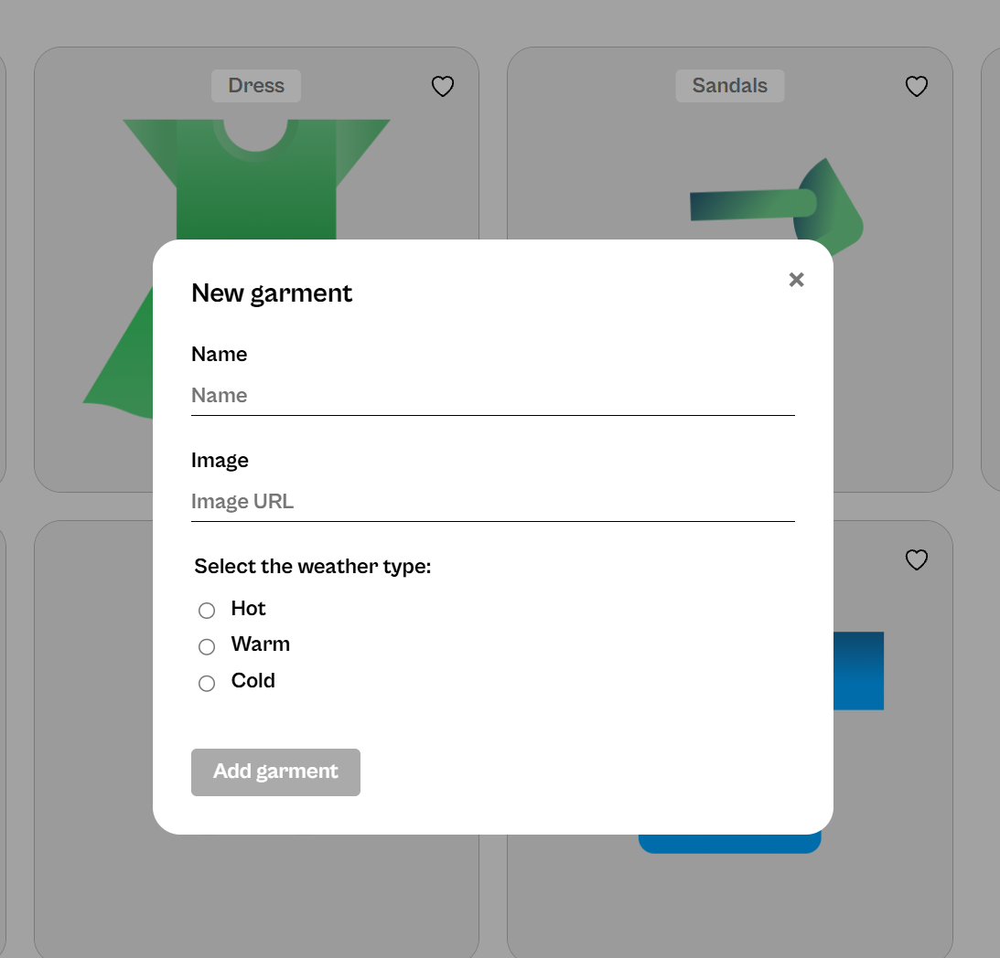

# WTWR (What to Wear)

## Features

 - Displays the weather and adjusts the recommended clothing depending on the temperature.
 - When clicking on a card it pops up and displays what the selected clothing item is for. 
 - I got the stylesheets connected and the apis working with each other. 

### Add a garment example

Add clothing by entering a name and image URL, then selecting the weather category: hot, warm, or cold.

- [Project repository][def]

[def]: https://github.com/RyanRenfrow/se_project_react